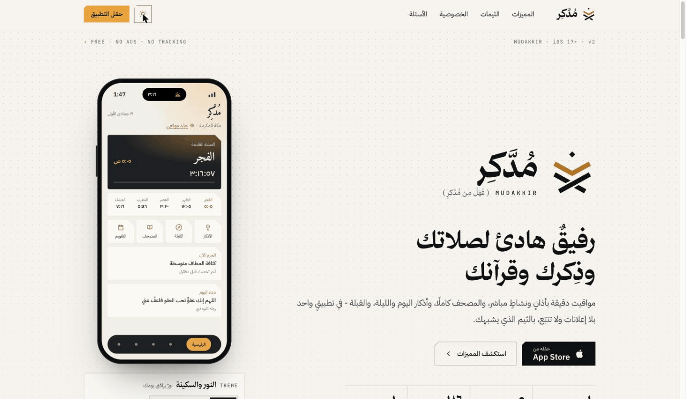
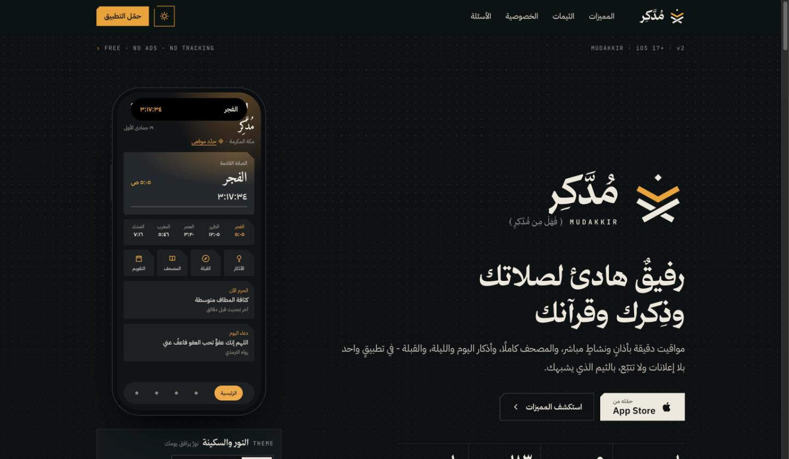
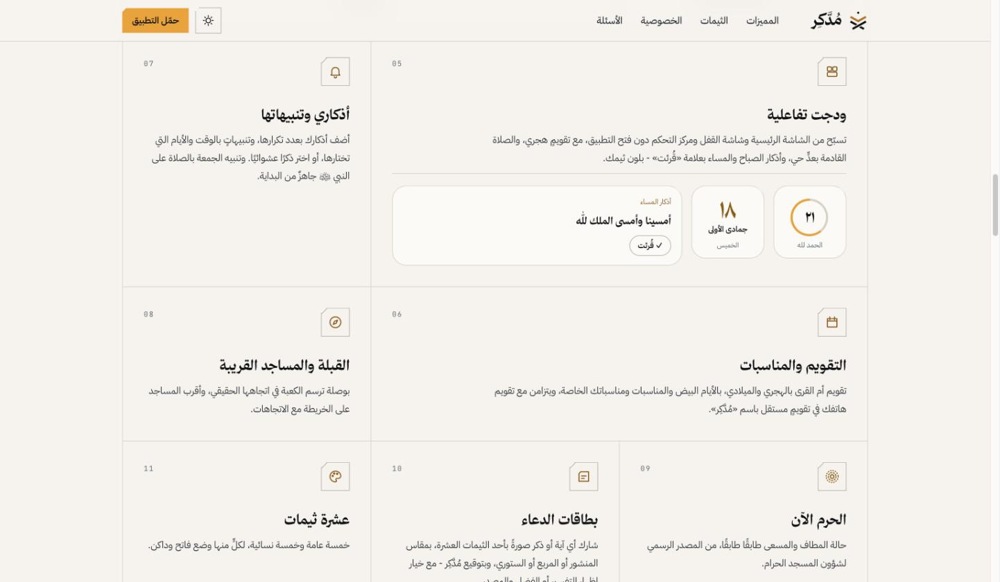
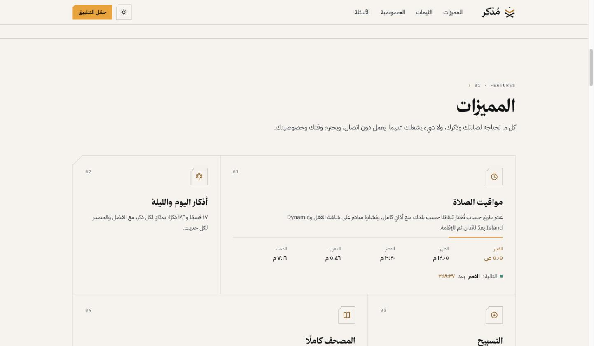
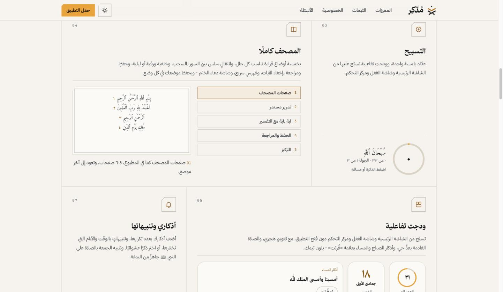
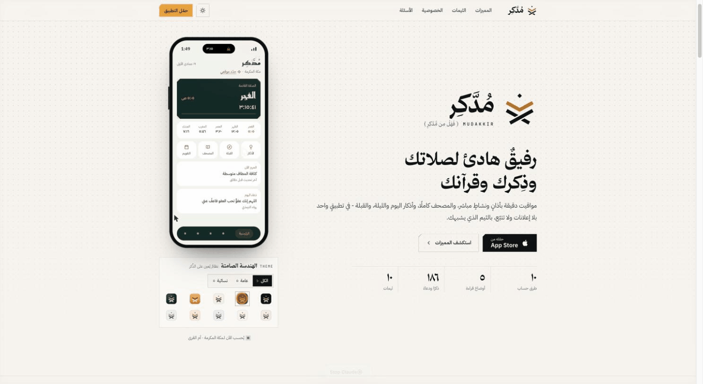
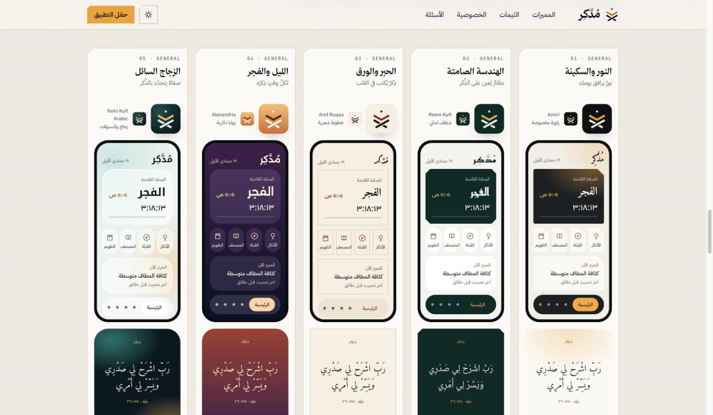
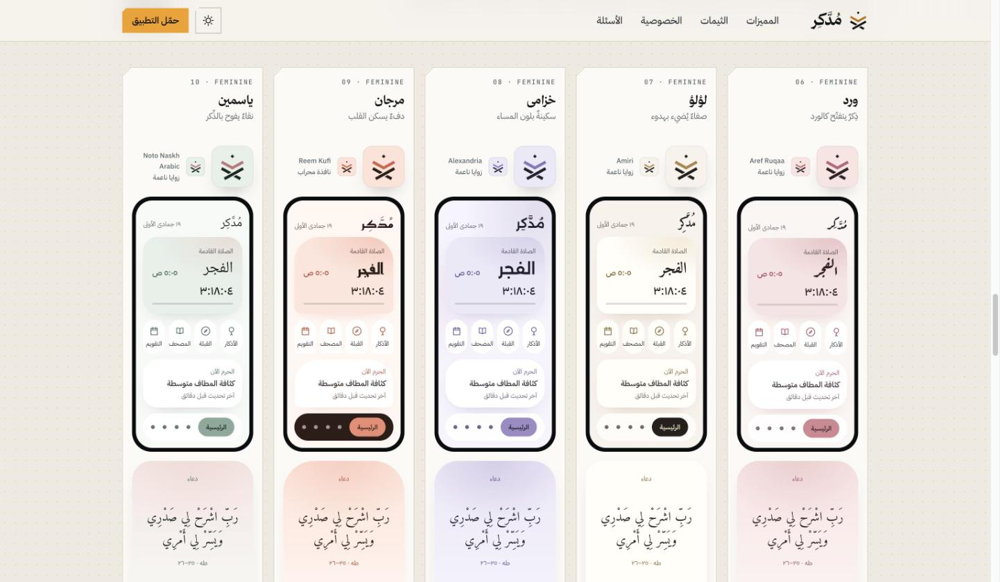
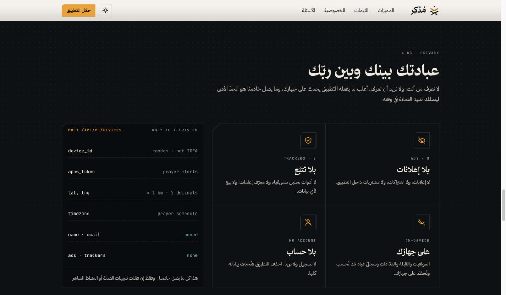

<div align="center">


# مُدَّكِر · Mudakkir

**﴿ فَهَلْ مِن مُّدَّكِرٍ ﴾**

### رفيقٌ هادئ لصلاتك وذِكرك وقرآنك

مواقيت دقيقة بأذانٍ ونشاطٍ مباشر، والمصحف كاملًا، وأذكار اليوم والليلة، والقبلة — في تطبيقٍ واحد بلا إعلانات ولا تتبّع، بالثيم الذي يشبهك.

[](https://apps.apple.com/app/id6759567041)
[](https://v.it-caf.com/)


| طرق حساب | أوضاع قراءة | ذكرًا ودعاءً | ثيمات |
|:---:|:---:|:---:|:---:|
| **١٠** | **٥** | **١٨٦** | **١٠** |

</div>

<p align="center">
  
</p>

<p align="center">
  
  
</p>

---

## ✨ المميزات

<p align="center"></p>

كل ما تحتاجه لصلاتك وذكرك، ولا شيء يشغلك عنهما. يعمل دون اتصال، ويحترم وقتك وخصوصيتك.

| # | الميزة | الوصف |
|:-:|---|---|
| 01 | 🕌 **مواقيت الصلاة** | عشر طرق حساب تُختار تلقائيًا حسب بلدك، مع أذانٍ كامل، ونشاطٍ مباشر على شاشة القفل وDynamic Island يعدّ للأذان ثم للإقامة. |
| 02 | 📿 **أذكار اليوم والليلة** | ١٧ قسمًا و١٨٦ ذكرًا، بعدّادٍ لكل ذكر، مع الفضل والمصدر لكل حديث. |
| 03 | 🔢 **التسبيح** | عدّاد بلمسة واحدة، وودجت تفاعلية تسبّح عليها من الشاشة الرئيسية وشاشة القفل ومركز التحكم. |
| 04 | 📖 **المصحف كاملًا** | خمسة أوضاع قراءة، وانتقال سلس بين السور، وخلفية ورقية أو ليلية، وحفظ ومراجعة بإخفاء الآيات، وفهرس سريع، ودعاء الختم — ويحفظ موضعك في كل وضع. |
| 05 | 🧩 **ودجت تفاعلية** | تسبيح وتقويم هجري والصلاة القادمة بعدٍّ حي وأذكار الصباح والمساء بعلامة «قُرئت» — بلون ثيمك. |
| 06 | 🗓️ **التقويم والمناسبات** | تقويم أم القرى بالهجري والميلادي، بالأيام البيض والمناسبات ومناسباتك الخاصة، ويتزامن مع تقويم هاتفك في تقويمٍ مستقل باسم «مُدَّكِر». |
| 07 | 🔔 **أذكاري وتنبيهاتها** | أضف أذكارك بعدد تكرارها وتنبيهاتٍ بالوقت والأيام، أو ذكرًا عشوائيًا، وتنبيه الجمعة بالصلاة على النبي ﷺ جاهز. |
| 08 | 🧭 **القبلة والمساجد القريبة** | بوصلة ترسم الكعبة في اتجاهها الحقيقي، وأقرب المساجد على الخريطة مع الاتجاهات. |
| 09 | 🕋 **الحرم الآن** | حالة المطاف والمسعى طابقًا طابقًا، من المصدر الرسمي لشؤون المسجد الحرام. |
| 10 | 🖼️ **بطاقات الدعاء** | شارك أي آية أو ذكر صورةً بأحد الثيمات العشرة، بمقاس المنشور أو المربع أو الستوري، مع خيار إظهار التفسير أو الفضل والمصدر. |
| 11 | 🎨 **عشرة ثيمات** | خمسة عامة وخمسة نسائية، لكلٍّ منها وضع فاتح وداكن. |
| 12 | 🤲 **التبرّع عبر إحسان** | رابط مباشر إلى منصة «إحسان» الوطنية — لا يمرّ عبرنا أي مبلغ. |
| 13 | 🔒 **الخصوصية أولًا** | بلا إعلانات ولا تتبّع ولا حسابات. المواقيت والقبلة تُحسب على جهازك. |

**وأيضًا:** أسماء الله الحسنى · متابعة العبادات · الحج والعمرة وعدّاد الأشواط · رمضان · أذكار الصغار · كتيّب الأذكار PDF · التسبيح الصوتي · منبّه الأذان · حجم الخط بمعاينة حية · Apple Watch · VoiceOver والخطوط الكبيرة · يعمل دون اتصال

### 📖 أوضاع المصحف الخمسة

1. **صفحات المصحف** — كما في المطبوع، ٦٠٤ صفحات، وتعود إلى آخر موضع
2. **تمرير مستمر**
3. **آية بآية مع التفسير**
4. **الحفظ والمراجعة**
5. **التركيز**

<p align="center"></p>

---

## 🎨 الثيمات — عشرة اتجاهات، روحٌ واحدة

الأيقونة والرئيسية وبطاقة الدعاء لكل ثيم بالمحتوى نفسه، ليظهر الفرق في الشخصية لا في المعلومة. ولكل ثيم وضعٌ فاتح وداكن.

<p align="center"></p>

| # | الفئة | الثيم | الشعار | الخط | الشكل |
|:-:|:-:|---|---|---|---|
| 01 | عامة | **النور والسكينة** | نورٌ يرافق يومك | Amiri | زاوية مقصوصة |
| 02 | عامة | **الهندسة الصامتة** | نظامٌ يُعين على الذِّكر | Reem Kufi | شطف ثماني |
| 03 | عامة | **الحبر والورق** | ذِكرٌ يُكتب في القلب | Aref Ruqaa | خطوط شعرية |
| 04 | عامة | **الليل والفجر** | لكلِّ وقتٍ ذِكرُه | Alexandria | زوايا دائرية |
| 05 | عامة | **الزجاج السائل** | صفاءٌ يتجدّد بالذِّكر | Noto Kufi Arabic | زجاج وكبسولات |
| 06 | نسائية | **ورد** | ذِكرٌ يتفتّح كالورد | Aref Ruqaa | زوايا ناعمة |
| 07 | نسائية | **لؤلؤ** | صفاءٌ يُضيء بهدوء | Amiri | زوايا ناعمة |
| 08 | نسائية | **خزامى** | سكينةٌ بلون المساء | Alexandria | زوايا ناعمة |
| 09 | نسائية | **مرجان** | دفءٌ يسكن القلب | Reem Kufi | نافذة محراب |
| 10 | نسائية | **ياسمين** | نقاءٌ يفوح بالذِّكر | Noto Naskh Arabic | زوايا ناعمة |

<p align="center">
  
  
</p>

---

## 🔒 الخصوصية — عبادتك بينك وبين ربّك

لا نعرف من أنت، ولا نريد أن نعرف. أغلب ما يفعله التطبيق يحدث على جهازك، وما يصل الخادم هو الحدّ الأدنى ليصلك تنبيه الصلاة في وقته.

| | |
|---|---|
| **ADS · 0** | لا إعلانات، ولا اشتراكات، ولا مشتريات داخل التطبيق |
| **TRACKERS · 0** | لا أدوات تحليل تسويقية، ولا معرّف إعلانات، ولا بيع لأي بيانات |
| **ON-DEVICE** | المواقيت والقبلة والعدّادات وسجلّ عباداتك تُحسب وتُحفظ على جهازك |
| **NO ACCOUNT** | لا تسجيل ولا بريد. احذف التطبيق فتُحذف بياناته كلها |

**كل ما يصل الخادم** — وفقط إن فعّلت تنبيهات الصلاة أو النشاط المباشر:

```http
POST /api/v1/devices        # ONLY IF ALERTS ON
```

| الحقل | القيمة | الغرض |
|---|---|---|
| `device_id` | random · not IDFA | تمييز الجهاز |
| `apns_token` | — | تنبيهات الصلاة |
| `lat, lng` | ≈ 1 km · منزلتان عشريتان | حساب المواقيت |
| `timezone` | — | جدول الصلاة |
| `name · email` | **never** | — |
| `ads · trackers` | **none** | — |

<p align="center"></p>

📄 [سياسة الخصوصية](https://v.it-caf.com/privacy) · [الشروط](https://v.it-caf.com/terms) · [الدعم](https://v.it-caf.com/support)

---

## ❓ أسئلة شائعة

<details><summary><b>هل التطبيق مجاني؟</b></summary>
نعم، مجاني بالكامل: بلا إعلانات، ولا اشتراكات، ولا مشتريات داخل التطبيق. هو صدقة جارية.
</details>
<details><summary><b>هل يعمل دون اتصال بالإنترنت؟</b></summary>
نعم — المواقيت والقبلة والمصحف والأذكار تعمل على جهازك دون اتصال.
</details>
<details><summary><b>كيف تُحسب مواقيت الصلاة؟</b></summary>
بعشر طرق حساب تُختار تلقائيًا حسب بلدك (أم القرى في السعودية)، ويمكنك تغييرها من الإعدادات.
</details>
<details><summary><b>كيف أغيّر الثيم؟</b></summary>
من الإعدادات ← الثيم، واختر من الثيمات العشرة بوضعها الفاتح أو الداكن.
</details>
<details><summary><b>هل يجمع التطبيق تبرّعات؟</b></summary>
لا. يوجد رابط مباشر إلى منصة «إحسان» الوطنية، ولا يمرّ عبرنا أي مبلغ.
</details>
<details><summary><b>ما الأجهزة المدعومة؟</b></summary>
iPhone بنظام iOS 17 أو أحدث، و Apple Watch.
</details>

المزيد على [v.it-caf.com/#faq](https://v.it-caf.com/#faq)

---

## 🌐 English

**Mudakkir** is a calm companion for your prayer, remembrance and Quran — a free iOS app with **no ads, no tracking and no account**.

- **Prayer times** — 10 calculation methods auto-selected by country, full adhan, Live Activity & Dynamic Island countdown to adhan then iqama
- **Adhkar** — 17 sections, 186 adhkar with counters, virtue and source
- **Tasbeeh** — one-tap counter + interactive widgets (Home, Lock Screen, Control Center)
- **Full Quran** — 5 reading modes (Mushaf pages · continuous · ayah-by-ayah with tafsir · memorization · focus), 604 pages, resumes where you left off
- **Calendar** — Umm Al-Qura Hijri/Gregorian, syncs into a separate "Mudakkir" calendar
- **Qibla & nearby mosques**, **Haram live status**, **shareable dua cards** in 3 sizes
- **10 themes** (5 general + 5 feminine), each with light & dark modes
- Apple Watch, VoiceOver, Dynamic Type, works offline · iOS 17+

---

<div align="center">

**﴿ فَهَلْ مِن مُّدَّكِرٍ ﴾**

مجاني، بلا إعلانات، صدقة جارية.

[](https://apps.apple.com/app/id6759567041)

📧 [support@it-caf.com](mailto:support@it-caf.com) · 𝕏 [@it_caf](https://x.com/it_caf) · 🛍️ [store.it-caf.com](https://store.it-caf.com/)

صُنع بواسطة **[iT CAF · كآف](https://github.com/iT-CAF)**

© 2026 iT CAF — جميع الحقوق محفوظة

</div>
